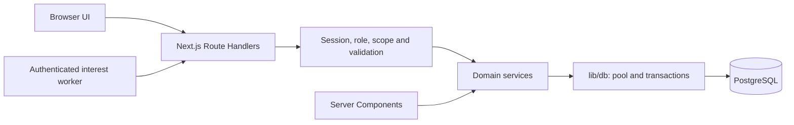

# B-Trust Microbanking and Interest Management System

**MIMS · CS3043 Database Systems Semester Project · Group 32**

MIMS digitises the core operations of B-Trust, a case-study microfinance bank in Sri Lanka: customer onboarding, savings accounts, cash transactions, fixed deposits, interest distribution, reporting and audit. Role-scoped screens let bank operators, QA testers and examiners demonstrate the underlying database guarantees.

This is a **database-first academic project**. PostgreSQL is the authoritative source of financial truth. Constraints, stored routines, transactions, locks, triggers and Row Level Security protect important rules even when a request bypasses the UI. All sample data is synthetic.

## Contents

- [Implementation status](#implementation-status)
- [Features and workflows](#features-and-workflows)
- [Team and responsibilities](#team-and-responsibilities)
- [Technology stack](#technology-stack)
- [Architecture and database design](#architecture-and-database-design)
- [Run locally](#run-locally)
- [Configuration](#configuration)
- [Using the application](#using-the-application)
- [API reference](#api-reference)
- [Tests and verification](#tests-and-verification)
- [Deployment](#deployment)
- [Repository structure](#repository-structure)
- [Documentation and development](#documentation-and-development)
- [Troubleshooting](#troubleshooting)

## Implementation status

Reconciled with the checked-out implementation on **13 October 2026**. The repository contains **70 numbered SQL migrations**; the generated [implemented database catalog](docs/18_implemented-database-catalog.md) records **28 public tables**. Customer/account workflows, transaction forms and receipts, staff transfers, savings/FD interest, maturity processing, five reports, audit and scoped record details/editing are implemented.

The [task tracker](docs/09_task-tracker.md) and [current state](.agent/current-state.md) retain formal review and acceptance gates. Historical notes can predate later merges; a merged change or successful local build does not establish final lecturer acceptance or complete live deployment verification. Dated [predeployment evidence](docs/21_predeployment-audit.md) and subsequent handoffs identify what each verification run covered.

Remaining boundaries include the final settlement policy for funded savings-account closure, complete consequential live-action acceptance, and actual Docker image/start validation where the Linux engine was unavailable. Automatic interest scheduling requires deployment configuration. No email sender, real KYC provider, interbank settlement, loans, card/ATM integration or multi-currency operation is supplied.

## Features and workflows

| Area | Implemented behavior |
| --- | --- |
| Identity and security | Argon2id passwords, server-side sessions, inactivity/absolute expiry, login throttling, role/branch checks, CSRF, admin access management and single-use password reset capabilities |
| Organisation | Branch/agent registration, scoped lists/details, permitted edits, deactivation and branch transfer controls |
| Customers | Registration, duplicate identity/email checks, search, profiles, effective-dated agent assignments, document references and authorized verification |
| Savings accounts | Eligibility-driven individual/joint opening, verified-document checks, primary/joint ownership, mandates, statements and manager status/mandate/holder controls |
| Ledger | Deposits, withdrawals, receipts, ordered statements, database-backed idempotency, minimum balances, business hours and debit limits |
| Staff transfers | Atomic paired debit/credit between permitted same-branch accounts; manager reversal compensates both legs |
| Fixed deposits | Product catalogue/rate history, opening quote, funded opening, one active FD per account, opening-term snapshots and linked account/owner details |
| Interest and maturity | 30-day FD payouts with overdue-period catch-up, funded-day savings interest, run previews/history/exceptions and automatic FD principal return |
| Reporting and audit | Five scoped reports, CSV export, report-access auditing, protected master/financial history and ledger/balance reconciliation |

FD opening terms remain read-only. Master-data edits do not allow arbitrary changes to balances, posted ledger entries or FD principal/rate. Savings-account closure requires zero balance, no active FD and no positive unpaid interest; a separate final settlement flow remains a policy question.

### Seeded products

These are synthetic baseline values; authorized product changes are stored in the database.

| Savings plan | Eligibility | Annual rate | Minimum balance (LKR) |
| --- | --- | --- | --- |
| Children | Under 13 | 12% | 0.00 |
| Teen | 13–17 | 11% | 500.00 |
| Adult | 18–59 | 10% | 1,000.00 |
| Senior | 60+ | 13% | 1,000.00 |
| Joint | 2–4 adult holders | 7% | 5,000.00 |

FD products are **6 months / 13%**, **12 months / 14%** and **36 months / 15%**. Each FD preserves the rate applicable at opening. One 30-day payout is calculated in SQL as `principal × annual_rate × 30 / 365`, rounded to cents and credited separately to its linked savings account. Savings interest uses the implemented funded-day calculation and period/rate snapshots. See [business rules](docs/07_business-rules.md).

## Team and responsibilities

The committed [workload division](docs/08_workload-division.md) documents **five members**. Names below combine its formal roster with each member's repository work overview. **Nadija completed the entire frontend**, as confirmed by the team, and this is listed as her first contribution. The remaining entries describe domain responsibilities and recorded database/backend, testing and documentation work; domain ownership does not imply authorship of its frontend.

| Member | Documented name and index | Responsibilities and implementation areas | Work overview |
| --- | --- | --- | --- |
| M1 — Nadija | Mansara W.G.N.S · 240420D | Complete frontend implementation for the entire application, identity tables, Argon2id authentication, sessions, RBAC/branch scope, CSRF, RLS/grants, parameters/calendar, audit and shared report/CSV framework; security tests | [Nadija](1_Nadija/00_OVERVIEW.md) |
| M2 — Vibodha | Herath H.M.V.L · 240225J | Branches, agents, customers, assignments/documents, registration/search/profile/activity APIs, duplicate checks and RPT-01; backend integration, documentation and recorded cross-owner completion | [Vibodha](2_Vibodha/00_OVERVIEW.md) |
| M3 — Nisith | Jayasuriya D.G.N.C · 240285P | Plans, accounts, holders, joint mandates, eligibility/opening routines, account management and RPT-02; holder, minimum-balance, constraint and concurrency tests | [Nisith](3_Nisith/00_OVERVIEW.md) |
| M4 — Pramudith | Jayawardhana P.S.P · 240298H | Pool/transaction/error helpers, channels, immutable ledger, deposit/withdrawal/reversal routines and APIs, receipt/statement services, reconciliation and RPT-05; rollback, idempotency, concurrency and performance tests | [Pramudith](4_Pramudith/00_OVERVIEW.md) |
| M5 — Selith | Rubasingha S.T · 240575P | FD products/deposits, runs/payouts, FD opening/calculation/cycle routines and APIs, seed framework, RPT-03/RPT-04 and interest/report/operations tests | [Selith](5_Selith/00_OVERVIEW.md) |

Cross-owner work is recorded separately without transferring original stewardship. Examples include M2's [seed completion](.agent/handoffs/p06-m02-seed-completion-cross-owner.md), [predeployment completion](.agent/handoffs/p06-m02-predeployment-completion.md), and [record details/edit/filter contribution](.agent/handoffs/p06-record-details-edit.md). The [ownership map](.agent/ownership-map.md), tracker and handoffs provide detailed evidence; Git author counts alone do not establish responsibility.

**Needs confirmation:** the earlier spoken request may have corrected the team size to four, while all committed roster/work-overview records list five. Confirm the final roster and any reassignment before replacing this table.

## Technology stack

| Layer | Repository technology |
| --- | --- |
| Runtime | Node.js **22.x**, pinned by `.nvmrc` and `package.json`; npm and committed lockfile |
| Web application | Next.js 15 App Router, React 19, strict TypeScript |
| UI | Tailwind CSS 3, GSAP for existing motion; shared patterns in `ui-registry.md` |
| Server/API | Next.js Route Handlers, domain services, Zod validation |
| Database access | `pg` / node-postgres, pooled handwritten parameterized SQL |
| Database | PostgreSQL **16** deployment target; verification supports 15+; `pgcrypto` and `pg_trgm` |
| Authentication | Argon2id, opaque session cookies and database session records |
| Tests/tooling | Node test runner, SQL/database fixtures, disposable PostgreSQL harness, ESLint and TypeScript |
| Deployment | Docker Compose; optional Neon PostgreSQL migration workflow and Vercel app configuration |

There is no ORM or backend-as-a-service, and no browser-to-database connection. Exact dependency versions come from `package-lock.json`.

## Architecture and database design



Server pages and API handlers authorize access; services own orchestration and transaction boundaries. **Only `lib/db` imports `pg`.** SQL values are parameterized, and dynamic sorting uses server allow-lists. Branch/assignment/self scope is applied inside queries, with RLS on customer, account and transaction data.

The schema connects users/roles to branch staff and optional customer logins; customers to assignments/documents and account holders; accounts to plans/mandates and ledger entries; and FDs to products, payouts, run controls and maturity receipts. Supporting tables hold sessions, audit, calendar, parameters and request/reset controls. The [physical catalog](docs/18_implemented-database-catalog.md) describes the current schema; the [schema document](docs/04_database-schema.md) preserves the original ERD and approved changes.

- **Exact money:** `NUMERIC(15,2)` amounts and `NUMERIC(6,4)` fractional rates; API money is a decimal string. SQL performs financial arithmetic.
- **Atomic posting:** lock the account, re-read its state, validate, insert ledger, update balance and record audit/control effects in one transaction.
- **Concurrency:** account row locks serialize decisions; transfers lock accounts in deterministic order. Failure rolls back the complete operation.
- **Immutable history:** corrections use linked compensating entries; posted ledger and audit history are protected from modification.
- **Replay safety:** database keys/control records preserve one financial effect and reject incompatible key reuse.
- **Interest isolation:** each FD due-period payout, savings distribution and maturity return has its own transaction. Run controls preserve earlier successes and exception evidence.
- **Least privilege:** `mims_owner` handles schema tooling; `mims_app` handles runtime access. Audit sanitizes sensitive fields; client errors conceal SQL and credentials.
- **Time:** instants use `TIMESTAMPTZ`; business dates/display use `Asia/Colombo`.

See [architecture](docs/03_architecture.md), [routine/view/index inventory](docs/16_database-routines-views-indexes.md) and [security/RBAC](docs/15_security-and-rbac.md).

## Run locally

### Option A — Docker app and PostgreSQL

Install Node 22 for the configuration generator, then start Docker Desktop in Linux-container mode or Docker Engine with Compose. From the repository root:

```sh
node scripts/configure-docker.mjs
docker compose --env-file .env.docker config --quiet
docker compose --env-file .env.docker up --build -d
docker compose --env-file .env.docker ps -a
```

Open [MIMS at localhost:3000](http://localhost:3000). The generator creates an ignored `.env.docker` with independent secrets and refuses to overwrite existing configuration. Compose starts private PostgreSQL 16, runs owner-only setup, then starts the standalone app after setup succeeds. Demo seeding runs only when enabled and the user table is empty. A named volume preserves data.

```sh
docker compose --env-file .env.docker logs setup
docker compose --env-file .env.docker logs -f app
docker compose --env-file .env.docker down
```

`down` preserves the database volume; adding `--volumes` deletes it permanently. The [Docker guide](docs/22_docker-setup.md) covers image/schema updates and rotation. Changing environment passwords alone does not rotate roles in an existing volume.

### Option B — Native Node.js and PostgreSQL

Prerequisites: Node **22.x**, npm **10+**, Git, PostgreSQL **16** (15+ supported), and PostgreSQL client/server binaries for verification. Make `pgcrypto` and `pg_trgm` available. On Windows the `db:create` helper requires Bash (for example Git Bash) and `psql` on its PATH; other npm commands can run in PowerShell.

```sh
git clone https://github.com/Database-Project-MIMS/B-Trust-Microbanking-and-Interest-Management-System.git
cd B-Trust-Microbanking-and-Interest-Management-System
npm ci --include=dev
```

Select Node 22 with your version manager. Using a local PostgreSQL administrator, create empty `mims_dev` and independent `mims_owner` / `mims_app` login roles:

```sh
npm run db:create
```

The Bash helper prompts for role passwords; independent generated hexadecimal values avoid SQL quote characters in this helper. For manual provisioning, follow [local setup](docs/10_local-setup.md). The owner owns the database/schema; the runtime role must not have superuser, schema ownership or owner-role membership.

Copy and fill the environment example privately:

```powershell
Copy-Item .env.example .env
```

On Bash use `cp .env.example .env`. Set both role-specific URLs to the same empty database and fill the required secrets below, then:

```sh
npm run db:rebuild
npm run db:status
npm run db:verify
npm run db:seed-validate
npm run dev
```

Open [MIMS at localhost:3000](http://localhost:3000). Rebuild applies migrations → routines → triggers → views → indexes → roles → ordered seed, then verifies setup. It already seeds the database; no extra seed step is needed. `db:migrate` applies pending numbered migrations; complete SQL runtime installation also requires the canonical setup/deployment stages. Applied checksums must remain intact.

**Disposable reset only:** `npm run db:rebuild -- --reset` deletes the configured public schema and reseeds it. It is restricted to `mims_dev` or `mims_test_*`; normal rebuild refuses a nonempty database. Back up wanted data before choosing reset.

For a production-style build use `npm run build`, then `npm start` with a separately configured production runtime. Public deployment requires HTTPS and the checks below.

## Configuration

`.env.example` deliberately has **blank credential fields**. Keep populated `.env`, `.env.docker` and `.env.neon` files local and ignored. Never put secrets in `NEXT_PUBLIC_*`, client code, screenshots or tracked documentation.

| Variable | Purpose / default |
| --- | --- |
| `DATABASE_URL` | Restricted `mims_app` runtime connection |
| `DATABASE_MIGRATION_URL` | `mims_owner` tooling connection; never supply it to a deployed app process |
| `SESSION_SECRET`, `CSRF_SECRET` | Independent application secrets required by the environment contract |
| `INTEREST_WORKER_TOKEN` | Independent bearer token for scheduled interest requests |
| `PGPOOL_MAX` | Bounded pool size, default `10` |
| `PGPOOL_IDLE_TIMEOUT_MS`, `PGPOOL_CONNECTION_TIMEOUT_MS` | Pool timeouts, defaults `30000` / `5000` |
| `PGSTATEMENT_TIMEOUT_MS` | Statement timeout, default `10000` |
| `SESSION_IDLE_TIMEOUT_MINUTES`, `SESSION_ABSOLUTE_TIMEOUT_HOURS` | Session limits, defaults `20` / `8` |
| `APP_BASE_URL` | Local `http://localhost:3000`; public HTTPS origin for deployment |
| `NODE_ENV` | `development` locally; `production` for deployed runtime |
| `PASSWORD_HASH_ALGORITHM` | Example specifies `argon2id` |
| `BUSINESS_HOURS_START`, `BUSINESS_HOURS_END`, `BANK_TIMEZONE` | Example defaults `08:30`, `16:30`, `Asia/Colombo`; operational parameters are authoritative in PostgreSQL |
| `LOG_LEVEL` | Example default `info` |

Generate a fresh value independently for each secret, keeping results private:

```sh
node -e "console.log(require('node:crypto').randomBytes(32).toString('hex'))"
```

Docker has separate variables in `.env.docker.example` and `.env.neon.example`; see [docs/22](docs/22_docker-setup.md). For another local port, change both port and `APP_BASE_URL`, for example `npm run dev -- --port 3001` and `http://localhost:3001`.

## Using the application

Start at `/sign-in`. The [operation guide](docs/13_system-operation-guide.md) lists demo usernames; the synthetic password is documented in the seed file header. Use these accounts only for local demonstration.

| Role | Typical screens and scope |
| --- | --- |
| `ADMIN` | Users/roles, parameters, audit, health, organisation and management reports |
| `CENTRAL_OPS` | Bank-wide permitted reads/reports, FD opening and interest console |
| `BRANCH_MANAGER` | Own branch agents/customers/accounts, permitted edits/mandates/closure, posting, reversals and reports |
| `AGENT` | Assigned customers, onboarding/verification, account opening and permitted posting |
| `AUDITOR` | Permitted read-only records, statements, reports and audit |
| `CUSTOMER` | Linked self profile/accounts/history/FDs and authorized own-account withdrawals; no staff transfers |
| `SYSTEM` | Internal worker posting identity; not an ordinary demo operator |

Server/query/database checks determine access. Registration does not automatically create a customer login or upload document contents; it stores document references. Administrators provision optional linked access separately.

A useful demonstration is: register → verify documents → open eligible individual/joint account → deposit/withdraw → inspect receipt/statement → open FD → preview/run due interest → inspect reports/audit/reconciliation. Show duplicate identity, underage holder, minimum-balance, replay and cross-branch rejection. The [current demonstration script](docs/demonstration-script.md) provides the role-by-role sequence.

The [seed specification](docs/06_seed-data-spec.md) records 3 branches, 6 ordinary agents, 15 customers, 10 savings accounts (2 joint), 12 FDs, 191 ledger entries, 3 interest runs and 30 payouts. Business dates/counts/totals are reproducible; generated IDs/references/timestamps need not be byte-identical. Historical seed dates do not establish current maturity behavior.

## API reference

The same Next.js application serves `/api`. Full endpoint roles, bodies, filters and errors are in [API/page contracts](docs/05_api-and-pages.md) and the [implemented API matrix](docs/19_implemented-api-matrix.md).

### Request and response conventions

- Login: `POST /api/auth/login`, JSON `{ "username": "…", "password": "…" }`. It requires JSON and rejects a supplied mismatching origin; failures are generic and throttled.
- Login sets opaque `mims_session` and readable `mims_csrf` cookies. Human mutations send the session cookies and `X-CSRF-Token` matching the CSRF cookie.
- Account opening, deposits, withdrawals, transfers, reversals and FD opening require `Idempotency-Key`. Reuse a key only for retrying the same operation/body. Interest uses cycle/run controls.
- Money is a decimal **string**, such as `"5000.00"`; IDs are UUIDs and date filters use `YYYY-MM-DD`. Actor identity/scope come from authenticated server context.
- Success normally uses `{ "data": ... }`; errors use `{ "error": { "code": "...", "message": "..." } }`. Logout returns `204` without a body. Report `format=csv` returns CSV.
- Common statuses: `400` invalid input, `401` unauthenticated, `403` forbidden/CSRF, `404` unavailable record, `409` business conflict, `422` semantic validation, `429` throttled, `500` safe unexpected failure; health can return `503`.

### Implemented route inventory

`{id}` / `{key}` are path parameters. Access varies by role; a route's presence does not grant access to every authenticated user.

| Area | Methods and paths |
| --- | --- |
| Authentication/reset | `POST /api/auth/login`, `POST /api/auth/logout`, `GET/POST /api/auth/reset` |
| Branches | `GET/POST /api/branches`, `GET/PATCH /api/branches/{id}` |
| Agents | `GET/POST /api/agents`, `GET/PATCH /api/agents/{id}`, `GET /api/agents/{id}/activity` |
| Customers | `GET/POST /api/customers`, `GET/PATCH /api/customers/{id}`, `GET /api/customers/{id}/fixed-deposits` |
| Document verification | `POST /api/customer-documents/{id}/verify` |
| Savings plans | `GET /api/plans`, `PATCH /api/plans/{id}` |
| Accounts | `GET/POST /api/accounts`, `GET/PATCH /api/accounts/{id}`, `POST /api/accounts/{id}/holders`, `POST /api/accounts/{id}/close`, `GET /api/accounts/{id}/transactions` |
| Ledger | `POST /api/transactions/deposits`, `POST /api/transactions/withdrawals`, `POST /api/transactions/transfers`, `GET /api/transactions/{id}`, `POST /api/transactions/{id}/reverse` |
| FD products | `GET /api/fd-products`, `PATCH /api/fd-products/{id}` |
| Fixed deposits | `GET/POST /api/fixed-deposits`, `GET /api/fixed-deposits/{id}`, `GET /api/fixed-deposits/quote` |
| Interest | `GET/POST /api/interest-runs` |
| Administration | `GET/POST /api/admin/users`, `PATCH /api/admin/users/{id}`, `POST /api/admin/users/{id}/reset`, `GET /api/admin/parameters`, `PUT /api/admin/parameters/{key}` |
| Audit/health | `GET /api/audit`, `GET /api/health` |
| Reports | `GET /api/reports/agent-transactions`, `GET /api/reports/account-summary`, `GET /api/reports/active-fds`, `GET /api/reports/interest-distribution`, `GET /api/reports/customer-activity` |

Reports permit ADMIN, CENTRAL_OPS, BRANCH_MANAGER and AUDITOR with manager branch scope. Report-specific filters/sort keys are in the API contracts. JSON pagination and CSV retain the authorized dataset and access auditing.

| Report | Purpose | Primary owner |
| --- | --- | --- |
| RPT-01 — Agent transactions | Agent-wise counts/totals | M2 |
| RPT-02 — Account summary | Account-wise summary and balance | M3 |
| RPT-03 — Active FDs | Active deposits and next payout dates | M5 |
| RPT-04 — Interest distribution | Monthly interest by account/product type | M5 |
| RPT-05 — Customer activity | Customer-wise ledger activity | M4 |

### Example: deposit request

After authorized staff login, send cookies, the current CSRF token and a new operation key. Replace IDs with real UUIDs from permitted account/channel data:

```http
POST /api/transactions/deposits
Content-Type: application/json
X-CSRF-Token: <current mims_csrf cookie value>
Idempotency-Key: demo-deposit-001
Cookie: <authenticated session and CSRF cookies>

{
  "accountId": "<account UUID>",
  "channelId": "<channel UUID>",
  "amount": "5000.00",
  "narration": "Synthetic demo deposit"
}
```

First successful deposit posting returns `201 { data: ... }`; valid replay returns `200` with the original result. Conflicting replay is rejected. The transaction owns ledger, balance and audit effects.

Human interest requests use `POST /api/interest-runs` with `{ "cycleDate": "YYYY-MM-DD", "dryRun": true }` for preview, `false` for execution, requiring ADMIN/CENTRAL_OPS session and CSRF. A worker without a session uses `Authorization: Bearer <INTEREST_WORKER_TOKEN>`. Future dates are rejected; completed-cycle replay returns the recorded run without duplicate payouts, while incomplete runs require operator review. Preview does not post funds but records request audit evidence. The endpoint does not install a scheduler.

`GET /api/health` requires a valid session. Ordinary roles receive basic status; ADMIN/CENTRAL_OPS also receive connectivity, pool and migration information.

## Tests and verification

Run from the root after dependency installation:

```sh
npm run typecheck
npm run lint
npm test
npm run test:db
npm run test:api
npm run test:security
npm run verify:operations
```

Use focused suites for a specific area; `npm test` runs combined tests. For full rebuild, tests, backup/restore, typecheck, lint and production-build verification:

```sh
npm run verify:phase1 -- --tap
```

Despite its historical name, `verify:phase1` is the current whole-project harness. It creates a disposable local PostgreSQL cluster with synthetic fixtures and cleans it up; it does not reset the configured development database. It needs PostgreSQL server/tools. Windows discovery checks versions 18/17/16/15 under Program Files; otherwise set `PG_BIN` or PATH. `--catalog` also regenerates docs/18 and docs/19, so use it only when intending those changes.

Coverage includes eligibility/constraints, atomic rollback, concurrent posting, idempotency/reversals, runtime-role RLS, role/endpoint denial, SQL injection, FD/interest controls, report/CSV totals, migration checksums and backup/restore. Dated receipts describe earlier implementation runs; this README update does not claim a new full runtime verification.

For isolated browser QA, `npm run verify:phase1 -- --preview` starts a synthetic preview and writes its URL to ignored `test-results/preview-url.json`. Follow [local setup](docs/10_local-setup.md#disposable-frontend-qa) to stop and clean it up.

## Deployment

- **Neon database:** [docs/23](docs/23_neon-migrations.md) describes `.github/workflows/neon-migrations.yml`. It validates on disposable PostgreSQL before deploying `dev` to staging or `main` to production with environment-specific direct TLS `mims_owner` secrets. Runtime uses `mims_app`. It does not seed/bootstrap users or deploy the app.
- **Vercel app:** [docs/24](docs/24_vercel-build.md) covers repository-root Next.js, Node 22, `npm ci --include=dev` and `npm run build`. Configure runtime secrets in deployment settings; keep the owner migration URL out of the app environment. Building the app does not deploy schema changes.
- **Docker with Neon:** run `node scripts/configure-docker.mjs --neon`, fill `.env.neon` privately, then `docker compose -f compose.neon.yaml --env-file .env.neon up --build -d`. The separate app-only stack uses localhost port 3001 and never migrates/seeds. Schema/bootstrap must exist first; see [docs/22](docs/22_docker-setup.md#run-the-docker-app-against-neon).

Production requires `NODE_ENV=production`, public HTTPS `APP_BASE_URL`, restricted database access and independent secrets. Run `npm run verify:deployment` with these variables supplied to the process. Configure TLS/proxy behavior, backups and authenticated scheduling separately, then test complete browser/API/database workflows. The localhost Docker demo does not establish production acceptance.

## Repository structure

```text
app/                    App Router pages and API Route Handlers
components/             Shared UI, shell, forms and reports
lib/auth/               Sessions, passwords, RBAC, CSRF and worker auth
lib/db/                 Only pg boundary; pool, transactions, RLS and errors
lib/validation/         Server-side schemas
services/               Domain orchestration and transaction boundaries
types/                  Shared TypeScript types
database/migrations/    Numbered immutable schema changes
database/routines/      PostgreSQL functions/procedures
database/triggers/      Integrity, immutability and audit
database/views/         Reporting and reconciliation views
database/indexes/       Indexes and justification
database/roles/         Runtime grants and RLS
database/seed/          Ordered synthetic fixtures
database/tests/         SQL-level tests
tests/                  DB, API, security, E2E and operations suites
scripts/                Setup, migration, verification and deployment
docs/                   Requirements, contracts, guides and evidence
.agent/                 State, ownership, decisions, checkpoints and handoffs
.claude/skills/         Project workflow skills
1_Nadija/ … 5_Selith/    Individual overviews and task guidance
.github/workflows/      CI and database deployment
```

## Documentation and development

| Need | Reference |
| --- | --- |
| Contract and required read order | [AGENTS.md](AGENTS.md), [documentation index](docs/00_documentation-index.md) |
| Design, schema and rules | [Architecture](docs/03_architecture.md), [schema](docs/04_database-schema.md), [rules](docs/07_business-rules.md), [physical catalog](docs/18_implemented-database-catalog.md) |
| API/pages | [Contracts](docs/05_api-and-pages.md), [implemented matrix](docs/19_implemented-api-matrix.md) |
| Ownership/progress | [Workload division](docs/08_workload-division.md), [ownership map](.agent/ownership-map.md), [tracker](docs/09_task-tracker.md) |
| Setup/operations | [Local setup](docs/10_local-setup.md), [Docker](docs/22_docker-setup.md), [demonstration](docs/demonstration-script.md), [operation guide](docs/13_system-operation-guide.md) |
| Security/verification | [Security/RBAC](docs/15_security-and-rbac.md), [testing/acceptance](docs/12_testing-and-acceptance.md), [predeployment audit](docs/21_predeployment-audit.md) |
| Decisions/questions | [ADRs](.agent/decisions/), [ERD gap analysis](docs/17_erd-gap-analysis.md), [open questions](.agent/open-questions.md) |
| UI conventions | [UI rules](docs/11_ui-rules.md), [registry](ui-registry.md) |

Follow assigned tasks/ownership, enforce important rules on the server/database, use parameterized SQL and exact decimal money. Applied migrations are immutable; corrections use a new migration in the assigned block. Update relevant contracts and handoffs with changes. The actual integration branch is `dev`; some historical examples say `develop`. Consult [Git workflow](docs/14_git-workflow.md) and [Neon workflow guidance](docs/23_neon-migrations.md) before integration.

## Troubleshooting

| Symptom | Check / action |
| --- | --- |
| Missing database configuration | Fill the appropriate ignored environment file privately; native tooling uses `.env`, Compose uses explicit `--env-file` |
| Authentication/permission failure | Match role/password/database; owner for schema tooling, restricted app role for runtime |
| Rebuild refuses nonempty database | Use empty database; choose reset only for an intentionally disposable allowed database |
| Changed applied checksum | Restore applied file and add a numbered correction; do not conceal edits in the ledger |
| Tests cannot find PostgreSQL | Install server/tools and set `PG_BIN` or PATH; remote connection alone is insufficient |
| Docker app will not start | Check Linux engine, `ps -a`, database health and `logs setup` |
| API `401` / `403` | Check active session, role, branch/assignment/self scope and CSRF; health is authenticated |
| Financial `409` | Check account state, funds/minimum, documents/mandate, hours/limits, active FD and key/body consistency |
| Port conflict/origin rejection | Match app port and `APP_BASE_URL`; retain same-origin login and CSRF checks |
| Vercel cannot load tooling | Use repository root, Node 22 and locked `npm ci --include=dev`; follow docs/24 |

Use synthetic identities and fixtures when reproducing issues. Do not include credentials, cookies or real customer records.
